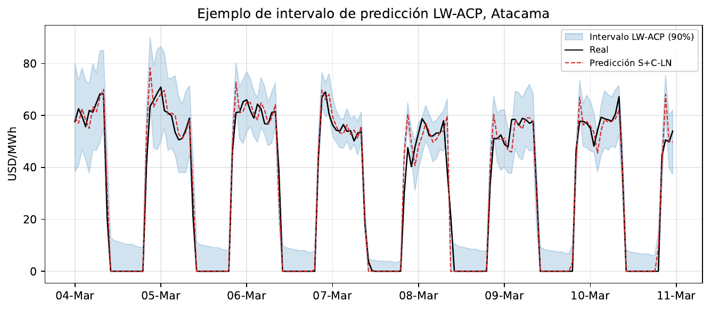
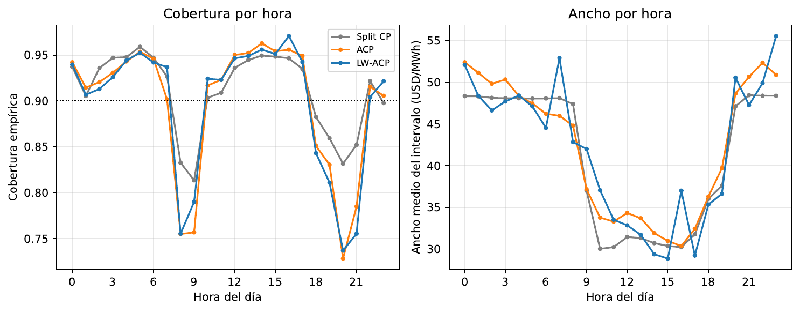
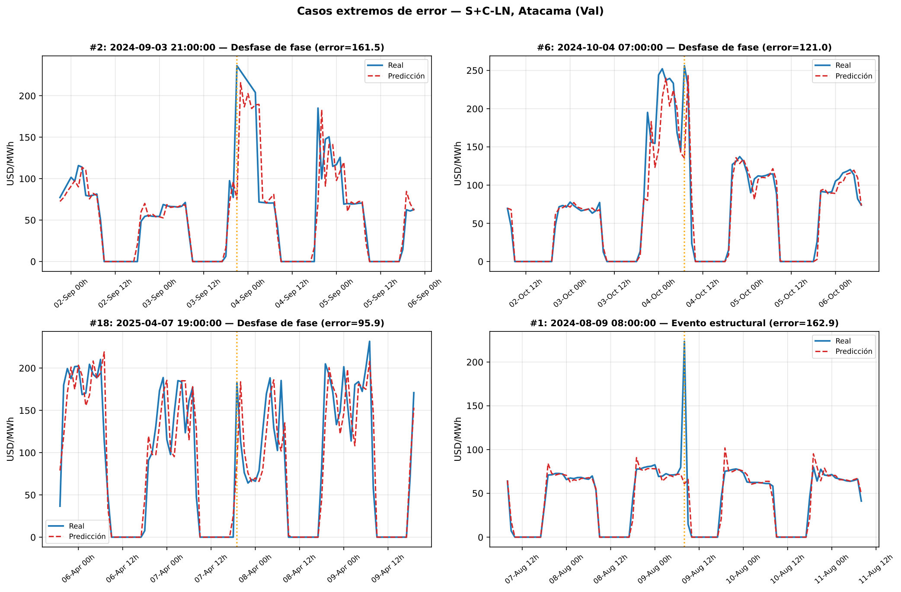

# Forecasting Chile's Hourly Marginal Electricity Cost with a Temporal Fusion Transformer

[-blue)](Escrito/main.pdf)


Code, data and LaTeX source for my thesis:

> **Posición Solar, Descomposición Estadística y Cuantificación de Incertidumbre mediante
> Temporal Fusion Transformer para el Forecasting del Costo Marginal en el SEN**
> *(Solar position, statistical decomposition and uncertainty quantification with a Temporal
> Fusion Transformer for forecasting the marginal cost in Chile's National Electric System)*
>
> Edward Benjamín Mitchell García. Thesis for the degrees of Ingeniero Civil en Matemáticas and
> Magíster en Matemáticas Aplicadas, Departamento de Ingeniería Matemática, Universidad de Chile.
> Advisor: Alejandro Jofré Cáceres. **Under final review.**

<p align="center">
  
</p>
<p align="center"><sub>One week at the Atacama busbar (March 2026): real cost (black), forecast (red) and the
90% LW-ACP interval (shaded), which narrows when solar oversupply drives the price to zero and widens at
the solar transitions. Axis labels are in Spanish, as in the thesis.</sub></p>

## The problem

Chile's National Electric System (SEN) moved quickly toward solar generation. The hourly marginal
cost now drops to 0 USD/MWh in the middle of most days and spikes during scarcity or transmission
congestion, which makes it much harder to forecast with classical statistical methods.

This work forecasts the **hourly marginal cost at eight representative 220 kV busbars** (Atacama,
Cardones, Charrúa, Crucero, Pan de Azúcar, Puerto Montt, Quillota and Tarapacá), January 2020 to
April 2026, about 55,000 hours per busbar, using data from the
[Coordinador Eléctrico Nacional](https://www.coordinador.cl) and weather from the
[Open-Meteo](https://open-meteo.com) archive (ERA5).

## Approach

* **Temporal Fusion Transformer (TFT)**, one model per busbar, one hour ahead.
* **Two exogenous feature strategies**:
  * **P+C (Prophet + weather):** Prophet's trend and seasonal components as known inputs,
    combined with a residual TFT through *Stacking Optimization*.
  * **S+C (sun + weather):** replaces the Prophet decomposition with deterministic **solar
    position** features (solar elevation, its cosine, daylight saving time) computed from each
    busbar's geolocation.
* **Two normalization layers** inside the Transformer: LayerNorm (LN) and Dynamic Tanh (DyT).
* **LW-ACP (Locally-Weighted Adaptive Conformal Prediction)**, proposed here: prediction intervals
  that combine hour-of-day weighting of the uncertainty with online adaptation of the coverage
  level.
* Model comparisons use the **Diebold–Mariano test** with Newey–West variance.

## Key results

All numbers are test-set results taken from the thesis.

**The simpler strategy wins one hour ahead.** At that horizon S+C beats P+C in **14 of 16**
busbar-architecture combinations, 13 of them statistically significant, so the solar position
signal is at least as informative as Prophet's statistical decomposition. The advantage does not
carry over to 24 hours: there P+C wins at three busbars, S+C at two, three show no significant
difference, and P+C's average error is about 4% lower. At that horizon S+C's appeal is coming close
to P+C with one model instead of Prophet, two TFTs and a stacking step. Variable importance is
consistent with this: solar position already carries Prophet's daily cycle but not its weekly
component or trend, and at 24 hours the models lean less on recent prices while P+C leans more on
the day of the week.

**Forecast horizon.** The main model forecasts the marginal cost **one hour ahead**, using the
price observed up to the previous hour. That is the same horizon as the closest Chilean precedent,
and against it the model reduces MAE by **20–34%** on the busbars evaluated by both.

**Against the system operator's schedule.** The CEN publishes a programmed marginal cost before
real operation. With one hour of lead time the model has 52–61% lower error, but most of that
comes from seeing the latest observed price. With a day of lead time (the 24-hour model) the
picture is mixed:

| Busbar | MAE (CEN) | MAE, 1 h ahead | MAE, 24 h ahead |
|---|---:|---:|---:|
| Pan de Azúcar | 15.09 | 6.93 | 13.64 |
| Charrúa | 17.01 | 7.98 | 18.41 |
| Puerto Montt | 32.98 | 13.68 | 38.89 |
| Crucero | 17.10 | 6.74 | 15.94 |
| Cardones | 14.52 | 6.63 | 15.32 |
| Quillota | 17.26 | 8.26 | 17.50 |

<sub>MAE in USD/MWh over the full test set. At 24 hours the point forecast does not beat
daily persistence at most busbars, while the prediction intervals stay calibrated.</sub>

**Better-calibrated uncertainty.** Intervals are reported at 90% nominal coverage, the level
used by the Conformal Prediction literature for electricity markets. At that level LW-ACP has the
best Winkler interval score and pinball loss of the five methods, with empirical coverage within
half a percentage point of the target at all eight busbars. No single method wins every metric:
online adaptation cuts the coverage deviation by 79% but makes the interval about 3% wider than
the fixed quantile.

| Method | Mean width (USD/MWh) | Mean \|coverage − 0.90\| | Mean Winkler score | Mean pinball loss |
|---|---:|---:|---:|---:|
| Split CP | 40.90 | 0.0112 | 76.65 | 1.916 |
| LW Split CP | **40.69** | 0.0108 | 76.23 | 1.906 |
| ACP (γ = 0.05) | 42.21 | **0.0023** | 72.31 | 1.808 |
| **LW-ACP (γ = 0.05)** | 41.98 | 0.0024 | **71.87** | **1.797** |
| CQR | 43.04 | 0.0142 | 72.53 | 1.813 |

At 95% nominal coverage LW-ACP is also the narrowest (58.25 USD/MWh, 8.7% narrower than Split CP),
with the lowest Winkler score (89.89).

Heavy-tailed errors limit the hourly weighting: LW-ACP scales each hour by the standard deviation
of its errors, which a few large errors inflate. A variant that scales each hour by a quantile of
its errors instead, with a floor chosen on validation only, lowers the 90% Winkler score at all
eight busbars (69.15), gives the narrowest intervals of all methods (40.40 USD/MWh) and nearly
halves the spread of coverage across hours ([`Scripts/piloto_lw_escala_robusta.py`](Scripts/piloto_lw_escala_robusta.py)).

<p align="center">
  
</p>

**Where the model fails.** Most of the largest errors are a **phase shift of about one hour** in
the daily solar transition (the model predicts the price jump one hour early or late), a pattern
that appears at all eight busbars. Puerto Montt, driven by hydro generation, remains unresolved:
none of the hydrological features tried improved on the general strategy. LayerNorm and Dynamic
Tanh are practically equivalent: LayerNorm's small one-hour edge does not hold at 24 hours.

<p align="center">
  
</p>

## Repository layout

```
Escrito/                  LaTeX source of the thesis and the compiled PDF (main.pdf)
Modulos/                  Python modules: data loading, preprocessing, Prophet, TFT,
                          DyT, stacking, evaluation and conformal prediction
Multi_modelo TFT *.ipynb  main experiment notebooks (hourly, daily, test runs)
Exploracion_Resultados.ipynb   results exploration
Scripts/                  analysis and plotting scripts
Scripts Cluster/          training and evaluation jobs for the university cluster (SLURM)
Multi-Modelos_TFT/        model configurations, metrics and conformal prediction results,
                          by granularity (h = hourly, D = daily, 15min) and architecture
Modelos_Prophet/          Prophet hyperparameters and component plots
Datos/                    marginal cost (hourly, daily, 15-minute), weather and hydrological data
docs/                     seminar slides, literature notes and README figures
```

## Reproducing

The exact environment is pinned in [`requirements.lock.txt`](requirements.lock.txt)
(PyTorch Lightning, PyTorch Forecasting, Prophet):

```bash
python -m venv venv_tesis && source venv_tesis/bin/activate
pip install -r requirements.lock.txt
```

The EnbPI baseline in `Modulos/Conformal_Prediction_Wrapper.py` uses M. Zaffran's
[AdaptiveConformalPredictionsTimeSeries](https://github.com/mzaffran/AdaptiveConformalPredictionsTimeSeries),
cloned into the repository root. Run the notebooks from the repository root: every path is
relative to it. Trained checkpoints and TensorBoard logs are not versioned; the notebooks and the
scripts in `Scripts Cluster/` regenerate them.

## License

The code is released under the [MIT License](LICENSE). The thesis text, figures and PDF remain
© Edward Benjamín Mitchell García. The LaTeX class in `Escrito/` belongs to FCFM, Universidad de
Chile, under its own license ([`Escrito/LICENSE`](Escrito/LICENSE)).
